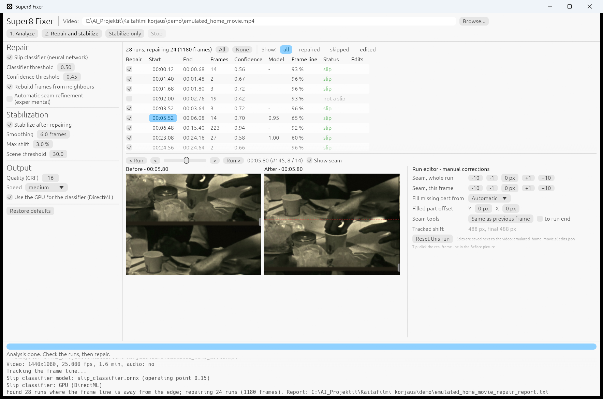

# Super8 Fixer

Repairs **frame-line slips** (framing errors) in digitized Super 8, 8 mm and other small-gauge film,
and **stabilizes** the picture. A native Windows application with a graphical interface and a command
line. Everything runs on your own computer.

When film slips in the scanner gate, the frame line (the dark gap between two film frames) slides
into the picture: the top of the video frame shows the bottom of one film frame and the bottom shows
the top of the next. Super8 Fixer finds these places, shifts every slipped frame back into position
and rebuilds the missing part from the neighbouring frames, so that the seam does not show.



*The run table, a slipped frame before and after the repair, and the run editor. The video is an emulated slip made from a Prelinger Archives home movie (CC BY 3.0).*

Made with Claude AI

## Features

- **Detection**: the frame line is tracked through the whole film (per-row features + Viterbi
  tracking). A small neural network (the *slip classifier*) tells real slips from straight
  horizontal edges in the picture, such as horizons, window frames and pavement edges.
- **Repair**: every slipped frame is rolled back into place. The missing strip is taken from the
  neighbouring frame (up to two frames away) that continues the picture best, aligned vertically and
  horizontally, matched in brightness and blended in. A leftover dark frame-line band is filled.
- **Review before rendering**: a table of all detected runs with a before/after preview of every
  frame. Untick false alarms, tick missed slips, and correct runs by hand in the run editor:
  - click the real frame line in the *Before* picture to place the seam there,
  - move the seam of the whole run or a single frame, copy it from the previous frame,
  - choose where the missing part comes from (automatic / previous / next frame / roll only),
  - nudge the filled part vertically and horizontally.

  Edits are saved next to the video (`VIDEO.s8edits.json`) and reapplied after a new analysis.
- **Stabilization**: removes gate weave and hand-held shake while keeping intentional camera moves.
  Global motion is measured by block matching on an image pyramid (median over blocks). Scene cuts
  and the duplicate frames of 18 fps film transferred to 25 fps video are detected, and the
  camera path is smoothed over real film frames only.
- **Learns from your corrections** (optional): `training/finetune_from_edits.py` fine-tunes the slip
  classifier with the runs you accepted or rejected. The personal model stays on your computer.

## Download and run

Requirements: Windows 10 or 11 (64-bit). A DirectX 12 GPU speeds up the classifier but is not required.

1. Download `Super8Fixer-<version>-win64.zip` from the Releases page and extract it.
2. Get ffmpeg: run `get-ffmpeg.cmd` in the folder, or copy `ffmpeg.exe` and `ffprobe.exe` into
   `Super8Fixer\ffmpeg\bin\` yourself (any recent build with libx264, for example from
   <https://github.com/BtbN/FFmpeg-Builds/releases> or <https://www.gyan.dev/ffmpeg/builds/>).
   ffmpeg on the PATH works too.
3. Start `Super8Fixer.exe`, or drop a video onto it.

## Use

1. Choose a video and press **1. Analyze**. A short film takes about a minute, a 30-minute film a few
   minutes.
2. Check the run table. Selecting a run shows a frame before and after the repair; the slider and the
   arrow keys step through the frames of the run, Page Up / Page Down move between runs. The *Repair*
   tick decides whether the run is repaired. Correct runs in the run editor when needed.
3. Press **2. Repair and stabilize**. The results are written next to the video:

   | file | content |
   |---|---|
   | `video_repaired.mp4` | frame-line slips repaired |
   | `video_repaired_stable.mp4` | also stabilized |
   | `video_repair_report.txt` | runs, confidence values and actions |
   | `video.s8edits.json` | your manual edits |

   Audio is copied from the original as it is. `video.s8analysis.bin` and `video.s8motion.bin` are
   caches that make a new run on the same video fast; they can be deleted.

**Stabilize only** stabilizes the chosen video without slip repair (`video_stable.mp4`).

## Command line

```
Super8Fixer.exe repair VIDEO [options]       repair frame-line slips -> VIDEO_repaired.mp4
Super8Fixer.exe stabilize VIDEO [options]    stabilize -> VIDEO_stable.mp4
Super8Fixer.exe all VIDEO [options]          both -> VIDEO_repaired_stable.mp4
Super8Fixer.exe help                         all options
```

Examples:

```
Super8Fixer.exe repair film.mp4 --analyze-only
Super8Fixer.exe repair film.mp4 --skip 03:37-03:44 --force 10:56-10:58
Super8Fixer.exe all film.mp4 --smoothing 10
```

## Building from source

Requirements: Rust 1.85 or newer (edition 2024) with the MSVC toolchain.

```
cargo build --release
```

Then copy `target\release\Super8Fixer.exe` and `target\release\DirectML.dll` into a folder with
`models\slip_classifier.onnx`, or run `scripts\package.ps1`, which builds the release folder and zip.
ONNX Runtime is linked statically by the `ort` crate (its prebuilt binaries are downloaded during the
first build).

## Training the slip classifier

The shipped model was trained only on **emulated** data: slips, frame lines, film grain and scanner
traits were generated on top of public-domain and CC BY amateur films and home movies from the
Prelinger Archives
(see [MODEL_CARD.md](MODEL_CARD.md)). No private home movies were used. The tools are in
[`training/`](training/README.md):

- `emulate.py` turns film transfers without slips into test and training videos with exact ground truth,
- `train_emulated.py` trains the classifier on them, `export_onnx.py` converts it for the application,
- `finetune_from_edits.py` fine-tunes it with your own corrections.

## Privacy

Super8Fixer.exe does not connect to the network. Videos, analyses and edits stay on your computer.
Only `get-ffmpeg.cmd`, when you run it, downloads ffmpeg from GitHub.

## License

Super8 Fixer is free for any **noncommercial** use: you may use, copy, modify and share it, but not
sell it or use it commercially. See [LICENSE.md](LICENSE.md) (PolyForm Noncommercial License 1.0.0).
The slip classifier model is licensed under CC BY-NC 4.0 (see [MODEL_CARD.md](MODEL_CARD.md)).

Third-party components keep their own licenses: see [THIRD_PARTY_NOTICES.md](THIRD_PARTY_NOTICES.md).
